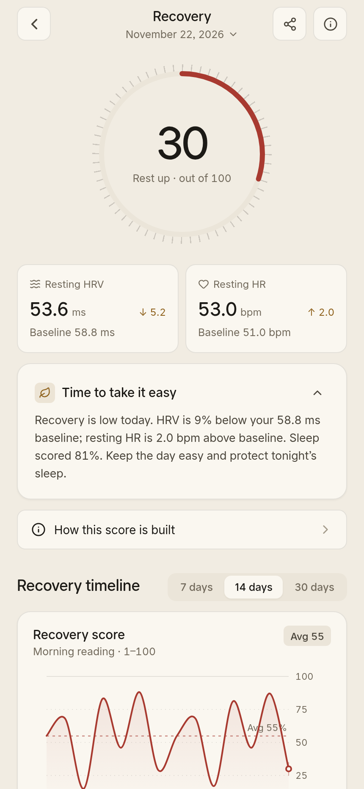
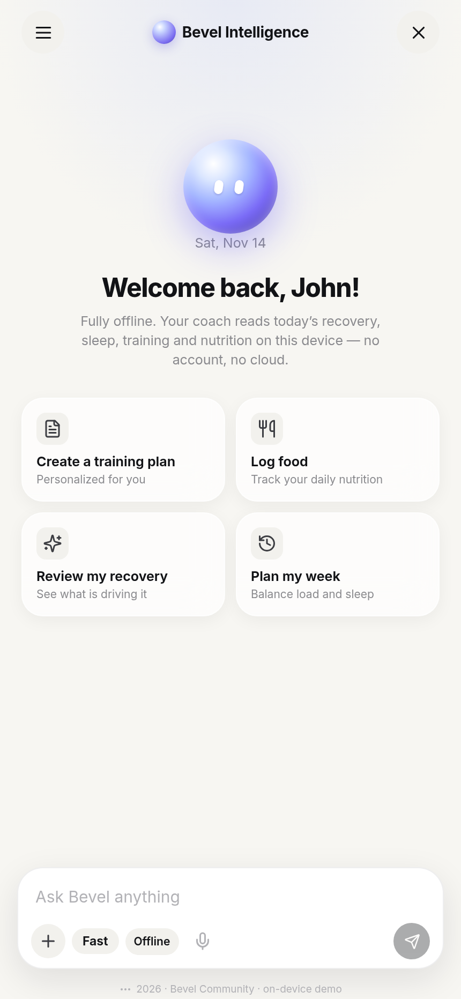

# Bene

**An offline-first, source-available health coach for iOS, Android and the web.**

Recovery, sleep, strain, training load, nutrition, journaling and biological age — built from a wearable-agnostic data model, with every score explained and every byte stored on your device.

> **Unofficial project.** Bene is an independent, clean-room community build inspired by publicly documented behaviour and public App Store screenshots of *Bevel: AI Health Coach*. It is **not affiliated with, endorsed by, or connected to Finerpoint, Inc.** “Bevel” is a trademark of its owner. See [NOTICE.md](NOTICE.md).

> **Licence.** Free for personal, research and other noncommercial use. Commercial use needs a separate paid licence — see [COMMERCIAL.md](COMMERCIAL.md).


## Why this exists

Most health apps put the most valuable part of your data — the interpretation — behind a subscription and a cloud account. This project explores the opposite: a **local-first** coach that runs entirely on your device, keeps working on a plane, and lets you take your data with you as a single file.

This is the first iteration. It is intentionally complete enough to use every day, and honest about what comes next.

## What works today

| Area | Status |
|---|---|
| **Offline by default** | ✅ No accounts, no telemetry, no network calls. All state in local storage / the app container. |
| **Backup & restore** | ✅ Download a single JSON backup, daily automatic on-device snapshot, validated restore from file. |
| **Demo dataset** | ✅ Deterministic 60-day history (sleep stages, HR/HRV, workouts, meals, journal) so every screen has real numbers on first launch. |
| **Recovery, Sleep, Strain** | ✅ Documented scoring model with calibration gates, personal baselines and explainable breakdowns. |
| **Training** | ✅ Cardio/muscular load, muscle freshness, structured routines, live workout timer, workout logging. |
| **Nutrition** | ✅ Calories, macros, net energy, 11 food-quality contributors, food search/custom foods. |
| **Journal** | ✅ Yes/No, Yes/Neutral/No and numeric tags, pinned tags, correlation insights after 5+5 entries. |
| **Biology** | ✅ Biological Age with a ± year estimate, contributor breakdown, biomarkers, health-record uploads (local). |
| **Coach** | ✅ Offline, scripted coach grounded in your metrics — no model calls. The UI is ready for a local or user-supplied model later. |
| **Native shells** | ✅ Capacitor iOS and Android projects included. |
| **Apple Health import** | ✅ Import `export.zip` / `export.xml` locally — sleep stages, overnight HRV/RHR, workouts, daily metrics and nutrition totals. Native HealthKit / Health Connect is the next milestone. |

## What's next

- **Native health adapters.** HealthKit and Health Connect behind one Capacitor plugin, feeding the same `DayRecord` contract as the Apple Health XML importer. See [docs/HEALTH_SOURCES.md](docs/HEALTH_SOURCES.md).
- **Optional on-device coach.** A local model can phrase the numbers later, with the rule-based coach as the always-available fallback. No cloud model is in scope.
- **Store builds.** The Capacitor projects are included; signing and packaging still happen in Xcode and Android Studio.

## Screens

| Home | Recovery | Sleep |
|---|---|---|
|  |  |  |

| Strain | Fitness | Nutrition |
|---|---|---|
|  |  |  |

| Journal | Biology | Coach |
|---|---|---|
|  |  |  |

## Quick start

Requirements: Node.js 20+ and npm.

```bash
npm install
npm run dev          # http://localhost:5173
```

First run opens a 3-step onboarding. Choose **See a sample day** to see the full 60-day dataset immediately, or enter your own name and start with an empty profile.

```bash
npm test             # scoring, backup, import and offline-coach invariants (23 tests)
npm run lint         # TypeScript project check
npm run build        # production web build in dist/
npm run preview      # serve the production build
```

### Visual and end-to-end checks

These use Playwright against a running dev server (install Chromium once with `npx playwright install chromium`):

```bash
npm run dev            # terminal 1
npm run shots          # capture every screen at 430×932, assert no overflow
npm run test:e2e       # navigation, logging, chat, workout start/finish, theme
npm run test:empty     # onboarding with no demo data
npm run test:import    # Apple Health export import
npm run test:backup    # snapshot, download, restore, import, invalid file, tabs
npm run test:pwa       # service worker + fully offline reload of the production build
```

`test:pwa` runs against `npm run preview` (port 4173) after `npm run build`; the others use the dev server on port 5173. The scripts live in `scripts/` and double as acceptance tests for the behaviours in `docs/`. Screenshots are written to `docs/screenshots/`; `npm run shots` is the visual review pass.

## iOS and Android

The native projects are already generated with [Capacitor](https://capacitorjs.com). The same TypeScript/React UI runs inside a native shell.

```bash
npm run build
npx cap sync
npm run cap:ios      # opens ios/App/App.xcworkspace in Xcode (macOS)
npm run cap:android  # opens android/ in Android Studio
```

- **iOS:** run `cd ios/App && pod install` once (CocoaPods), then open `ios/App/App.xcworkspace`, select a signing team, and run on a device or simulator. `npx cap sync` runs `pod install` automatically when CocoaPods is available. Deployment target and bundle id live in Xcode and `capacitor.config.ts`.
- **Android:** open `android/`, let Gradle sync, run on a device or emulator. `minSdk` is 34 (Android 14+); `applicationId` is `health.bene.community`.
- **Web/PWA:** `npm run build` also emits a manifest and service worker. Serve `dist/` over HTTPS to install it as a standalone app.

No native build is required for development — the web target is the fastest iteration loop and is what the automated screenshot suite uses.

## Backups: the important part

There is no server, so a backup file **is** your account.

- **Create backup** → writes a timestamped snapshot to the device and downloads `bene-backup-YYYY-MM-DD.json`.
- **Daily automatic snapshot** → once per 24 hours, saved on-device.
- **Restore** → validates the file/snapshot, then replaces the current data. Invalid, foreign or newer-version backups are rejected without touching your data.
- Backups include profile, settings, every day of metrics, meals, workouts, journal entries, biomarkers, records, routines and chat history.

The format is a plain JSON document (`app: "bene"`, `version: 1`). It is **not encrypted** — treat it like a lab report. See [docs/BACKUP.md](docs/BACKUP.md).

## Scoring, in one paragraph

Every score is a pure function of your data with a published invariant list. Recovery requires two complete nights, sleep stages, overnight HRV and overnight RHR; it blends sleep score, HRV, RHR, temperature, respiratory rate and SpO₂ against a 28-night personal baseline. Strain uses logarithmic TRIMP load and can exceed 100%. Nutrition follows the 11 published food-quality contributors, including the sodium and added-sugar dead bands. Biological Age combines nine PhenoAge-style markers with sleep, activity and fitness contributors, and only updates weekly. The vendor does not publish its weights, so this build uses an independent, documented model and keeps every weight in one place.

Read [docs/SCORING.md](docs/SCORING.md) for formulas, gates, weights and the known gaps.

## Architecture

```
src/
  domain/            pure TypeScript: types, scoring, seed data, backup
  store/             Zustand store + persistence (localStorage)
  components/        design system, charts, icons
  screens/           one file per surface
  styles/            tokens + screen CSS
ios/, android/       Capacitor native shells
scripts/             Playwright visual + end-to-end checks
docs/                scoring, architecture, backup, health-source notes
```

- **UI:** React 19 + TypeScript + Vite, no chart library — charts are hand-built SVG for control and small bundles.
- **State:** Zustand with a persisted data slice; scoring is never stored, only derived.
- **Native:** Capacitor 7; web assets are bundled into the app, so it works with the radio off.
- **Design:** warm ivory canvas, white cards, Inter, large tabular numerals, one accent per metric. Dark mode included; the sleep detail is always night-themed.

More detail in [docs/ARCHITECTURE.md](docs/ARCHITECTURE.md).

## Privacy

- No analytics, no crash reporting, no remote logging, no third-party scripts.
- No network requests in the app source (`fetch`, `XMLHttpRequest`, `axios` are absent).
- Health data stays in the app's local storage. Backups are user-initiated files.
- The demo dataset is synthetic; names and values are fictional.
- This is a wellness tool, not a medical device, and not a diagnosis.

## Contributing

Issues and pull requests are welcome. Start with [CONTRIBUTING.md](CONTRIBUTING.md). Scoring changes must include a test and a note in `docs/SCORING.md`. Please keep the app offline-first: no telemetry and no required network dependency.

## License

Source is available under the [PolyForm Noncommercial License 1.0.0](LICENSE). Personal, hobby, research and other noncommercial use is free. **Commercial use requires a separate paid licence** — see [COMMERCIAL.md](COMMERCIAL.md). “Bevel” and any third-party marks remain the property of their owners; see [NOTICE.md](NOTICE.md).
