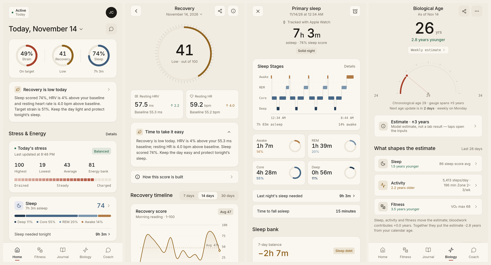
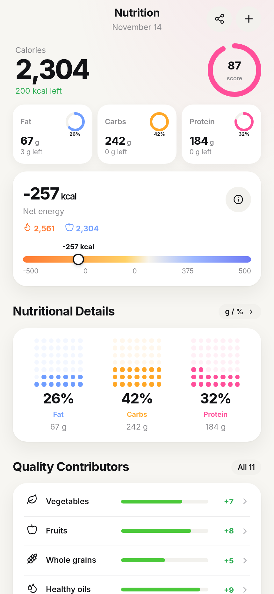
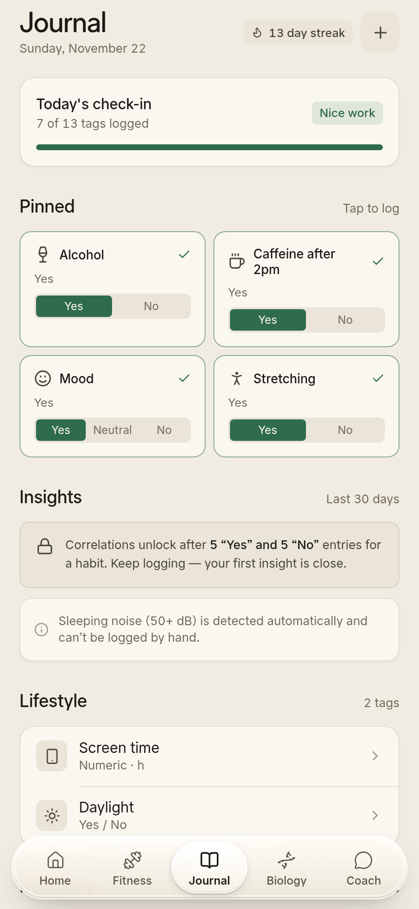

# Bene

**A health coach for iOS, Android and the web. It works offline. Its source is available.**

Bene calculates recovery, sleep, strain, training load, nutrition, journaling and biological age. It uses a data model that does not depend on one wearable brand. It explains each score. It stores all data on your device.

> **Licence.** Bene is free for personal, research and other noncommercial use. Commercial use needs a separate paid licence. See [COMMERCIAL.md](COMMERCIAL.md).



## Why this exists

Most health apps put the interpretation of your data behind a subscription and a cloud account. Bene does not. Bene is a local-first coach. It runs on your device. It continues to work when the device has no network connection, for example on a plane. You can move your data to another device as one file.

This is the first iteration. It has sufficient features for daily use. This document also describes what comes next.

## What works today

| Area | Status |
|---|---|
| **Offline by default** | ✅ Bene has no accounts, no telemetry and no network calls. It keeps all state in local storage or the app container. |
| **Backup and restore** | ✅ Bene downloads one JSON backup file. It makes an automatic on-device snapshot each day. It validates a restore from a file. |
| **Demo dataset** | ✅ A deterministic 60-day history includes sleep stages, HR/HRV, workouts, meals and journal entries. Each screen has values at first run. |
| **Recovery, Sleep, Strain** | ✅ A documented scoring model uses calibration gates and personal baselines. Each score has a breakdown. |
| **Training** | ✅ Bene calculates cardio load and muscular load. It gives muscle freshness, structured routines, a live workout timer and workout logging. |
| **Nutrition** | ✅ Bene tracks calories, macros and net energy. It has 11 food-quality contributors, food search and custom foods. |
| **Journal** | ✅ Journal tags support Yes/No, Yes/Neutral/No and numeric values. You can pin tags. Bene displays correlation insights after 5+5 entries. |
| **Biology** | ✅ Biological Age has a ± year estimate, a contributor breakdown, biomarkers and local health-record uploads. |
| **Coach** | ✅ The coach works offline and uses scripts. It answers from your metrics and makes no model calls. The UI can use a local or user-supplied model later. |
| **Native shells** | ✅ The repository includes Capacitor iOS and Android projects. |

## What's next

- **Native health adapters.** Bene will add adapters for native health stores. One Capacitor plugin will connect HealthKit and Health Connect. The plugin will supply the same `DayRecord` contract that the rest of the domain uses.
- **Optional on-device coach.** A local model can phrase the numbers later. The rule-based coach remains the always-available fallback. No cloud model is in scope.
- **Store builds.** The repository includes the Capacitor projects. You still sign and package in Xcode and Android Studio.

## Screens

| Home | Recovery | Sleep |
|---|---|---|
|  |  |  |

| Strain | Fitness | Nutrition |
|---|---|---|
|  |  |  |

| Journal | Biology | Coach |
|---|---|---|
|  |  |  |

## Quick start

Requirements: Node.js 20+ and npm.

```bash
npm install
npm run dev          # http://localhost:5173
```

The first run opens a 3-step onboarding. Choose **See a sample day** to load the full 60-day dataset immediately. Or enter your name and start with an empty profile.

```bash
npm test             # scoring, backup and offline-coach invariants
npm run lint         # TypeScript project check
npm run build        # production web build in dist/
npm run preview      # serve the production build
```

### Visual and end-to-end tests

These tests use Playwright against a running dev server. Install Chromium one time with `npx playwright install chromium`.

```bash
npm run dev            # terminal 1
npm run shots          # capture every screen at 430×932, assert no overflow
npm run test:e2e       # navigation, logging, chat, workout start/finish, theme
npm run test:empty     # onboarding with no demo data
npm run test:backup    # snapshot, download, restore, import, invalid file, tabs
npm run test:pwa       # service worker + fully offline reload of the production build
```

`test:pwa` runs against `npm run preview` on port 4173 after `npm run build`. The other tests use the dev server on port 5173. The scripts are in `scripts/`. They also operate as acceptance tests for the behaviour in `docs/`. Screenshots go to `docs/screenshots/`. `npm run shots` is the visual review pass.

## iOS and Android

Capacitor generated the native projects. The same TypeScript/React UI runs in a native shell.

```bash
npm run build
npx cap sync
npm run cap:ios      # opens ios/App/App.xcworkspace in Xcode (macOS)
npm run cap:android  # opens android/ in Android Studio
```

- **iOS:** Run `cd ios/App && pod install` one time (CocoaPods). Then open `ios/App/App.xcworkspace`. Select a signing team. Run on a device or simulator. `npx cap sync` runs `pod install` automatically when CocoaPods is available. The deployment target and bundle id are in Xcode and `capacitor.config.ts`.
- **Android:** Open `android/` and let Gradle sync. Run on a device or emulator. `minSdk` is 34 (Android 14+). `applicationId` is `health.bene.community`.
- **Web/PWA:** `npm run build` also emits a manifest and service worker. Serve `dist/` over HTTPS to install it as a standalone app.

You do not need a native build for development. The web target has the shortest development loop. The automated screenshot suite uses the web target.

## Backups: the important part

Bene has no server. A backup file **is** your account.

- **Create backup:** Bene writes a timestamped snapshot to the device and downloads `bene-backup-YYYY-MM-DD.json`.
- **Daily automatic snapshot:** Bene saves a snapshot on the device one time each 24 hours.
- **Restore:** Bene validates the file or snapshot, then replaces the current data. Bene rejects an invalid, foreign or newer-version backup without a change to your data.
- Backups include profile, settings, every day of metrics, meals, workouts, journal entries, biomarkers, records, routines and chat history.

The format is a plain JSON document (`app: "bene"`, `version: 1`). It is **not encrypted**. Treat it like a lab report. See [docs/BACKUP.md](docs/BACKUP.md).

## Scoring, in one paragraph

Each score is a pure function of your data and has a published list of invariants. Recovery needs two complete nights, sleep stages, overnight HRV and overnight RHR. It blends sleep score, HRV, RHR, temperature, respiratory rate and SpO₂ against a 28-night personal baseline. Strain uses logarithmic TRIMP load and can exceed 100%. Nutrition follows the 11 published food-quality contributors, including the sodium and added-sugar dead bands. Biological Age combines nine PhenoAge-style markers with sleep, activity and fitness contributors. It updates only each week. The exact weights are not public. This build uses an independent, documented model and keeps all weights in one place.

Read [docs/SCORING.md](docs/SCORING.md) for formulas, gates, weights and the known gaps.

## Architecture

```
src/
  domain/            pure TypeScript: types, scoring, seed data, backup
  store/             Zustand store + persistence (localStorage)
  components/        design system, charts, icons
  screens/           one file per surface
  styles/            tokens + screen CSS
ios/, android/       Capacitor native shells
scripts/             Playwright visual + end-to-end checks
docs/                scoring, architecture and backup notes
```

- **UI:** The UI uses React 19, TypeScript and Vite. It has no chart library. We hand-build the charts in SVG for control and small bundle size.
- **State:** State uses Zustand with a persisted data slice. Bene never stores scoring data. It derives the scores.
- **Native:** Native uses Capacitor 7. Capacitor bundles the web assets into the app. It works with the radio off.
- **Design:** The design uses a warm ivory canvas, white cards, Allo, large tabular numerals and one accent for each metric. Bene includes dark mode. The sleep detail always uses the night theme.

More detail in [docs/ARCHITECTURE.md](docs/ARCHITECTURE.md).

## Privacy

- Bene has no analytics, no crash reporting, no remote logging and no third-party scripts.
- The app source has no network requests (`fetch`, `XMLHttpRequest`, `axios` are absent).
- Health data stays in the local storage of the app. Backups are files that the user creates.
- The demo dataset is synthetic. The names and values are fictional.
- This is a wellness tool. It is not a medical device and it does not give a diagnosis.

## Contributing

You can open issues and pull requests. Start with [CONTRIBUTING.md](CONTRIBUTING.md). A scoring change must include a test and a note in `docs/SCORING.md`. Keep the app offline-first. Do not add telemetry or a required network dependency.

## License

The source is available under the [PolyForm Noncommercial License 1.0.0](LICENSE). Personal, hobby, research and other noncommercial use is free. **Commercial use requires a separate paid licence.** See [COMMERCIAL.md](COMMERCIAL.md). Third-party components and the NOOP formula attribution are in [NOTICE.md](NOTICE.md).
