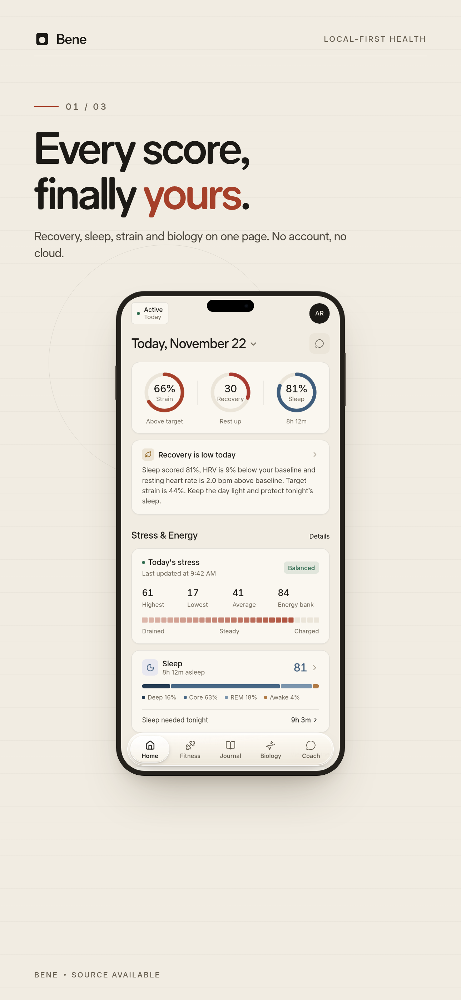
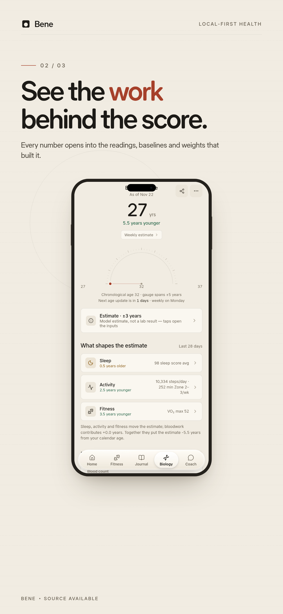
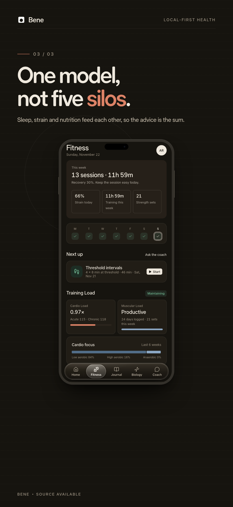

<p align="center">
  <picture>
    <source media="(prefers-color-scheme: dark)" srcset="docs/brand-lockup-dark.png">
    
  </picture>
</p>

<p align="center">
  <a href="https://github.com/chatRG/bene/releases/latest"></a>
  
  
  
  
</p>

**A health coach for iOS, Android and the web. It works offline. Its source is available.**

Bene calculates recovery, sleep, strain, training load, nutrition, journaling and biological age. The data model does not depend on one wearable brand. Bene explains each score and stores all data on your device.

> **Licence.** Bene is free for personal, research and other noncommercial use. Commercial use needs a separate paid licence. See [COMMERCIAL.md](COMMERCIAL.md).

## Why this exists

Most health apps put the interpretation of your data behind a subscription and a cloud account. Bene does not. Bene is a local-first coach, and it runs on your device. It continues to work when the device has no network connection. You can move your data to another device as one file.

## Features

| Area | What it does |
|---|---|
| **Offline by default** | No account, no telemetry, no network call. All state stays in local storage or the app container. |
| **Backup and restore** | One JSON file. Bene writes a snapshot on the device each day. Bene validates a restore before it replaces any data. |
| **Recovery, Sleep, Strain** | A documented scoring model with calibration gates and personal baselines. Every score shows a breakdown. |
| **Training** | Cardio load, muscular load, muscle freshness, structured routines, a workout timer and workout logging. |
| **Nutrition** | Calories, macros and net energy across 11 food-quality contributors. Food search and custom foods. |
| **Journal** | Yes/No, Yes/Neutral/No and numeric tags. Pinned tags. Correlation insights after 5 + 5 entries. |
| **Biology** | Biological Age with a ± year estimate, a contributor breakdown, biomarkers and local health-record upload. |
| **Coach** | Works offline from your own metrics. Script-based, with no model call. |
| **Native shells** | Capacitor iOS and Android projects in the repository. |

## Screens

<p align="center">
  
  
  
</p>

## Quick start

You need Bun 1.2 or later.

```bash
bun install
bun run dev          # http://localhost:5173
```

The first run opens onboarding. It asks for your name, birth date, height and weight. The app then starts empty. Every score fills in as you log or import data.

```bash
bun run test         # scoring, backup and offline-coach invariants
bun run lint         # TypeScript project check
bun run build        # production web build in dist/
bun run preview      # serve the production build
```

### Visual and end-to-end tests

These tests use Playwright against a running dev server. Install Chromium one time with `bunx playwright install chromium`.

```bash
bun run dev            # terminal 1
bun run shots          # capture every screen at 430x932, assert no overflow
bun run test:e2e       # navigation, logging, chat, workout start and finish, theme
bun run test:empty     # onboarding and first-run empty state
bun run test:backup    # snapshot, download, restore, import, invalid file, tabs
bun run test:pwa       # service worker and a fully offline reload of the production build
```

Run `test:pwa` against `bun run preview` on port 4173 after `bun run build`. The other tests use the dev server on port 5173. The scripts are in `scripts/`. The tests also operate as acceptance tests for the behaviour in `docs/`. Screenshots go to `docs/screenshots/`.

## iOS and Android

Capacitor generated the native projects. The same TypeScript and React interface runs in a native shell.

```bash
bun run build
bunx cap sync
bun run cap:ios      # opens ios/App/App.xcworkspace in Xcode (macOS)
bun run cap:android  # opens android/ in Android Studio
```

- **iOS:** Run `cd ios/App && pod install` one time (CocoaPods). Then open `ios/App/App.xcworkspace`. Select a signing team. Run on a device or simulator. `bunx cap sync` runs `pod install` automatically when CocoaPods is available. The deployment target and the bundle id are in Xcode and `capacitor.config.ts`.
- **Android:** Open `android/` and let Gradle sync. Run on a device or emulator. `minSdk` is 34 (Android 14 or later). `applicationId` is `health.bene.community`.
- **Web/PWA:** `bun run build` also emits a manifest and a service worker. Serve `dist/` over HTTPS to install it as a standalone app.

### Install without a store

Each tagged release attaches an Android APK and an unsigned iOS IPA.

- **Android.** Install the APK directly. The APK is release-signed, so it updates over itself on Android 14 or later.
- **iOS.** Install the unsigned IPA with AltStore, SideStore or Sideloadly. Those tools sign it again on your device with your own Apple account. You cannot publish an `.ipa` with a signature, because a signature belongs to one developer identity and one provisioning profile. An App Store build needs a paid Apple Developer account and a review.

The `iOS unsigned` workflow builds the IPA on a macOS runner with `CODE_SIGNING_ALLOWED=NO` in the Release configuration. A Debug build fails after the tools sign it again, because it carries the `get-task-allow` entitlement.

You do not need a native build for development. The web target has the shortest development loop, and the screenshot suite uses the web target.

## How it works, and where your data lives

**Architecture.** React 19, TypeScript and Vite, with hand-built SVG charts. `src/domain/` holds pure logic, `src/store/` persists, and `src/screens/` renders. The `ios/` and `android/` directories are Capacitor shells around the same interface. See [docs/ARCHITECTURE.md](docs/ARCHITECTURE.md).

**Your data.** Bene has no server, so a backup file is your account. The file is plain JSON. Bene writes it every 24 hours and validates it before a restore. The file is **not encrypted**, so treat it like a lab report. See [docs/BACKUP.md](docs/BACKUP.md).

**Privacy.** Bene has no analytics, no telemetry, no network call and no upload. Bene is a wellness tool. It is not a medical device.

## Contributing

You can open issues and pull requests. Start with [CONTRIBUTING.md](CONTRIBUTING.md). A scoring change needs a test and a note in `docs/SCORING.md`. Keep the app offline-first. Do not add telemetry or a network dependency that the app requires.

## License

The source is available under the [PolyForm Noncommercial License 1.0.0](LICENSE). Personal, hobby, research and other noncommercial use is free. **Commercial use needs a separate paid licence.** See [COMMERCIAL.md](COMMERCIAL.md). Third-party components and the NOOP formula attribution are in [NOTICE.md](NOTICE.md).
