<p align="center">
  <picture>
    <source media="(prefers-color-scheme: dark)" srcset="docs/brand-lockup-dark.png">
    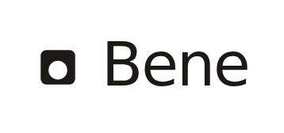
  </picture>
</p>

<p align="center">
  <a href="https://github.com/chatRG/bene/releases/latest"></a>
  
  
  
  
</p>

**A health coach for iOS, Android and the web. It works offline. Its source is available.**

Bene calculates recovery, sleep, strain, training load, nutrition, journaling and biological age. It uses a data model that does not depend on one wearable brand. It explains each score. It stores all data on your device.

> **Licence.** Bene is free for personal, research and other noncommercial use. Commercial use needs a separate paid licence. See [COMMERCIAL.md](COMMERCIAL.md).

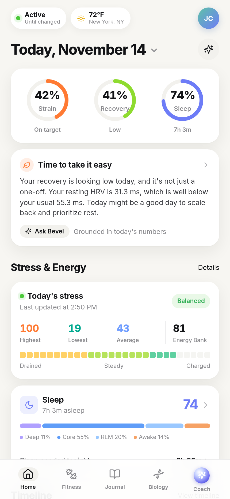

## Why this exists

Most health apps put the interpretation of your data behind a subscription and a cloud account. Bene does not. Bene is a local-first coach. It runs on your device. It continues to work when the device has no network connection, for example on a plane. You can move your data to another device as one file.

## Features

| Area | What it does |
|---|---|
| **Offline by default** | No accounts, no telemetry, no network calls. All state stays in local storage or the app container. |
| **Backup and restore** | One JSON file. An automatic on-device snapshot each day. A restore is validated before it replaces anything. |
| **Recovery, Sleep, Strain** | A documented scoring model with calibration gates and personal baselines. Every score has a breakdown. |
| **Training** | Cardio and muscular load, muscle freshness, structured routines, a live workout timer and workout logging. |
| **Nutrition** | Calories, macros and net energy across 11 food-quality contributors, with food search and custom foods. |
| **Journal** | Yes/No, Yes/Neutral/No and numeric tags. Pinned tags. Correlation insights after 5+5 entries. |
| **Biology** | Biological Age with a ± year estimate, a contributor breakdown, biomarkers and local health-record uploads. |
| **Coach** | Works offline from your own metrics, script-based, no model calls. |
| **Native shells** | Capacitor iOS and Android projects in the repository. |

## Screens

| Home | Recovery | Sleep |
|---|---|---|
|  |  | 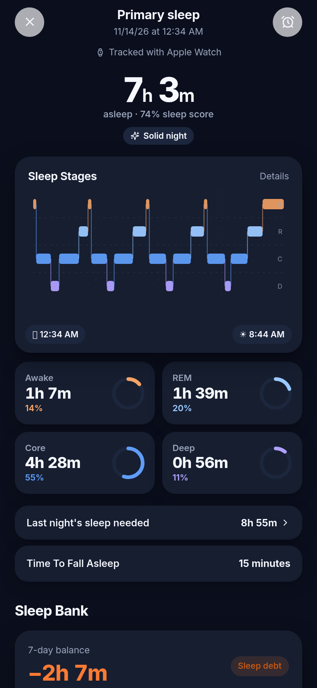 |

| Strain | Fitness | Nutrition |
|---|---|---|
| 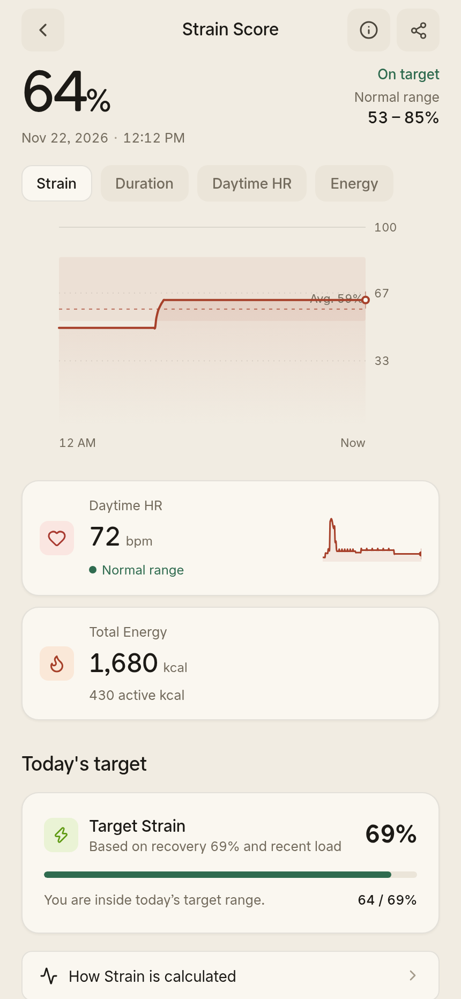 | 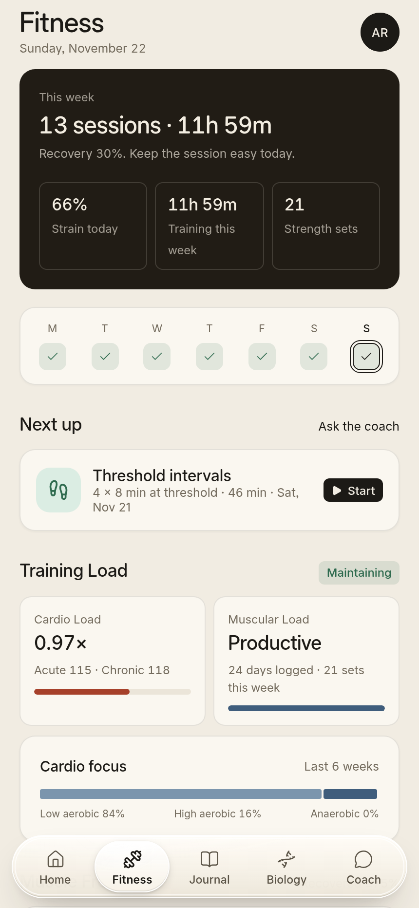 |  |

| Journal | Biology | Coach |
|---|---|---|
|  | 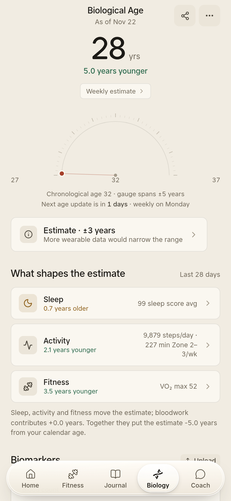 |  |

### Dark mode

Bene ships a dark theme and a true-black midnight theme. The screenshots below use the dark theme.

| Home | Recovery | Sleep |
|---|---|---|
| 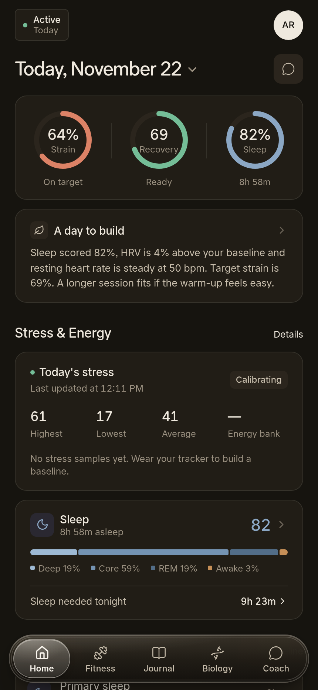 | 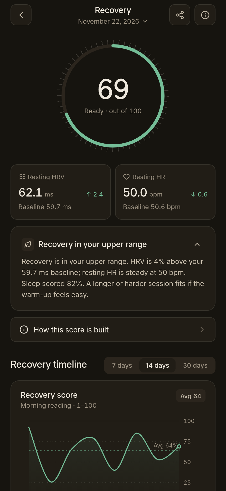 | 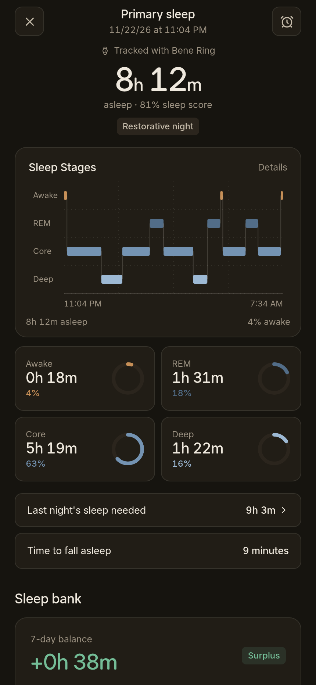 |

| Strain | Fitness | Nutrition |
|---|---|---|
| 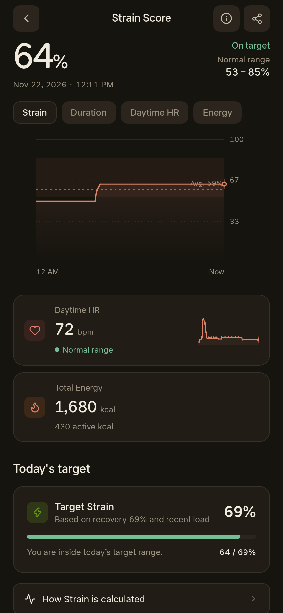 | 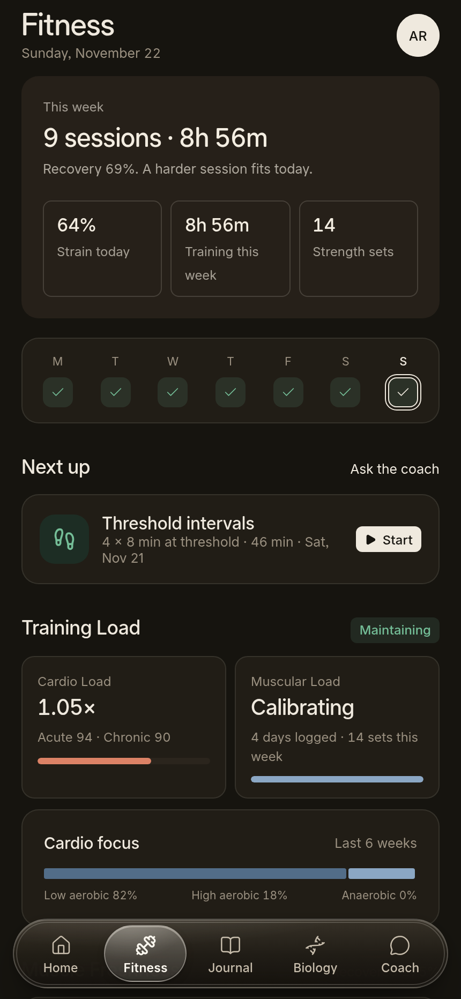 | 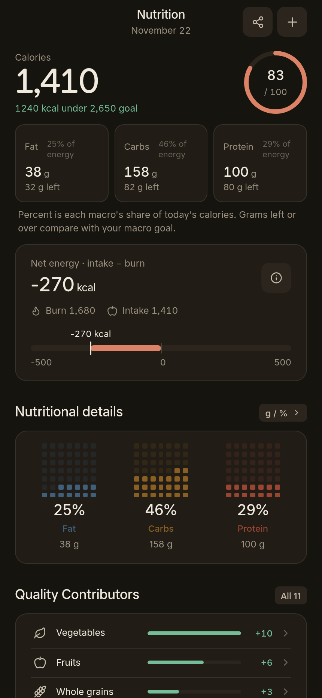 |

| Journal | Biology | Coach |
|---|---|---|
| 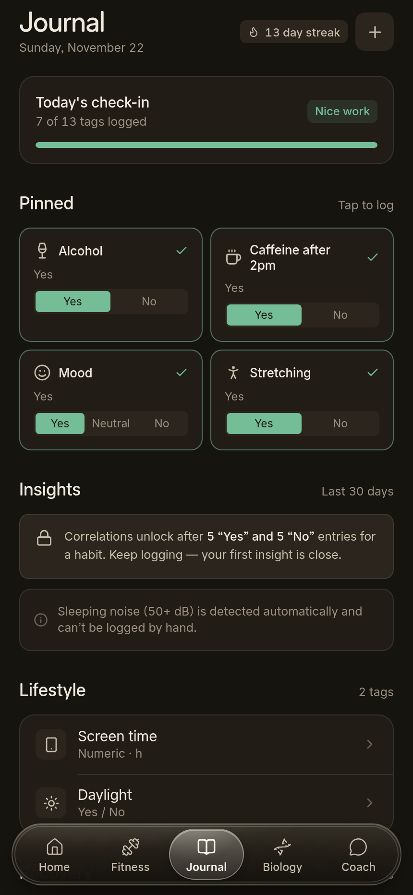 | 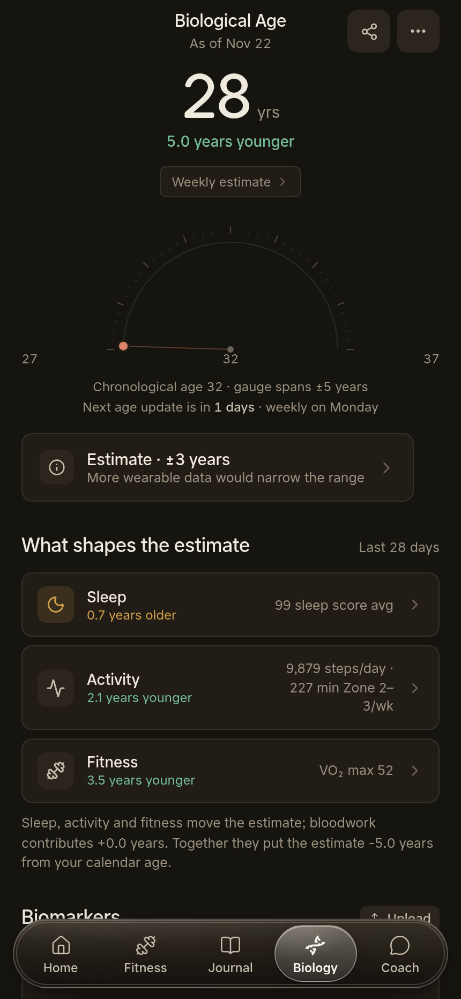 | 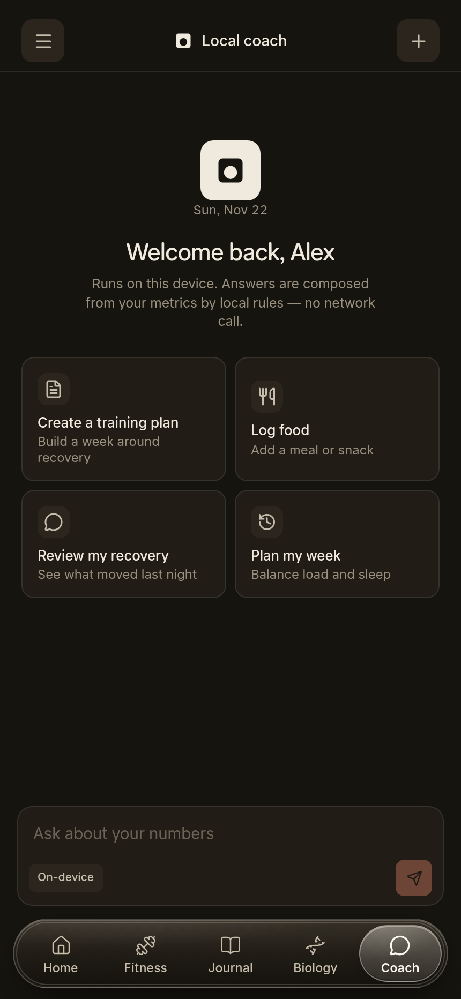 |

## Quick start

Requirements: Bun 1.2+.

```bash
bun install
bun run dev          # http://localhost:5173
```

The first run opens onboarding. It asks for your name, birth date, height and weight. The app then starts empty. Every score fills in as you log or import data.

```bash
bun run test             # scoring, backup and offline-coach invariants
bun run lint         # TypeScript project check
bun run build        # production web build in dist/
bun run preview      # serve the production build
```

### Visual and end-to-end tests

These tests use Playwright against a running dev server. Install Chromium one time with `bunx playwright install chromium`.

```bash
bun run dev            # terminal 1
bun run shots          # capture every screen at 430×932, assert no overflow
bun run test:e2e       # navigation, logging, chat, workout start/finish, theme
bun run test:empty     # onboarding and first-run empty state
bun run test:backup    # snapshot, download, restore, import, invalid file, tabs
bun run test:pwa       # service worker + fully offline reload of the production build
```

`test:pwa` runs against `bun run preview` on port 4173 after `bun run build`. The other tests use the dev server on port 5173. The scripts are in `scripts/`. They also operate as acceptance tests for the behaviour in `docs/`. Screenshots go to `docs/screenshots/`. `bun run shots` is the visual review pass.

## iOS and Android

Capacitor generated the native projects. The same TypeScript/React UI runs in a native shell.

```bash
bun run build
bunx cap sync
bun run cap:ios      # opens ios/App/App.xcworkspace in Xcode (macOS)
bun run cap:android  # opens android/ in Android Studio
```

- **iOS:** Run `cd ios/App && pod install` one time (CocoaPods). Then open `ios/App/App.xcworkspace`. Select a signing team. Run on a device or simulator. `bunx cap sync` runs `pod install` automatically when CocoaPods is available. The deployment target and bundle id are in Xcode and `capacitor.config.ts`.
- **Android:** Open `android/` and let Gradle sync. Run on a device or emulator. `minSdk` is 34 (Android 14+). `applicationId` is `health.bene.community`.
- **Web/PWA:** `bun run build` also emits a manifest and service worker. Serve `dist/` over HTTPS to install it as a standalone app.

### Installing without a store

Each tagged release attaches an Android APK and an unsigned iOS IPA.

- **Android.** Install the APK directly. It is release-signed, so it updates over itself on Android 14+.
- **iOS.** Install the unsigned IPA with AltStore, SideStore or Sideloadly. Those tools re-sign it on your device with your own Apple account. An `.ipa` cannot be published pre-signed: a signature belongs to one developer identity and provisioning profile, so only that account could install it. An App Store build needs a paid Apple Developer account and review.

The `iOS unsigned` workflow builds the IPA on a macOS runner with `CODE_SIGNING_ALLOWED=NO` in the Release configuration. A Debug build would fail after re-signing, because it carries the `get-task-allow` entitlement.

You do not need a native build for development. The web target has the shortest development loop. The automated screenshot suite uses the web target.

## Backups

Bene has no server, so a backup file **is** your account. You can download `bene-backup-YYYY-MM-DD.json`, and a snapshot is written on the device every 24 hours. A restore is validated before it replaces anything, so an invalid or foreign file changes nothing. Everything is included: profile, settings, days, meals, workouts, journal, biomarkers, records, routines and chats.

The file is plain JSON (`app: "bene"`, `version: 1`) and is **not encrypted**. Treat it like a lab report. See [docs/BACKUP.md](docs/BACKUP.md).

## Scoring

Every score is a pure function of your data with a published set of invariants. Recovery needs two complete nights, sleep stages, overnight HRV and RHR, then blends sleep, HRV, RHR, temperature, respiratory rate and SpO₂ against a 28-night personal baseline. Strain is logarithmic TRIMP and can exceed 100%. Nutrition follows 11 food-quality contributors, with sodium and added-sugar dead bands. Biological Age combines nine PhenoAge-style markers with sleep, activity and fitness, and updates weekly.

Formulas, gates, weights and known gaps are in [docs/SCORING.md](docs/SCORING.md).

## Architecture

```
src/domain/     pure TypeScript: types, scoring, backup
src/store/      Zustand store, persisted to localStorage
src/screens/    one file per surface
src/styles/     tokens and screen CSS
ios/, android/  Capacitor 8 native shells
```

React 19, TypeScript and Vite. The charts are hand-built SVG, with no chart library. The store persists data only — scores are always derived, never stored. The design uses a warm ivory canvas, Allo, and one accent per metric, in light, dark and midnight themes. The mark is **Threshold**, a circular opening cut through a square field, in ink and cream only ([brand/](brand/README.md)).

More detail in [docs/ARCHITECTURE.md](docs/ARCHITECTURE.md).

## Privacy

No analytics, no crash reporting, no remote logging and no third-party scripts. The source contains no network requests. Health data stays on your device, and backups exist only as the files you choose to create. Bene is a wellness tool: it is not a medical device and it gives no diagnosis.

## Contributing

You can open issues and pull requests. Start with [CONTRIBUTING.md](CONTRIBUTING.md). A scoring change must include a test and a note in `docs/SCORING.md`. Keep the app offline-first. Do not add telemetry or a required network dependency.

## License

The source is available under the [PolyForm Noncommercial License 1.0.0](LICENSE). Personal, hobby, research and other noncommercial use is free. **Commercial use requires a separate paid licence.** See [COMMERCIAL.md](COMMERCIAL.md). Third-party components and the NOOP formula attribution are in [NOTICE.md](NOTICE.md).
